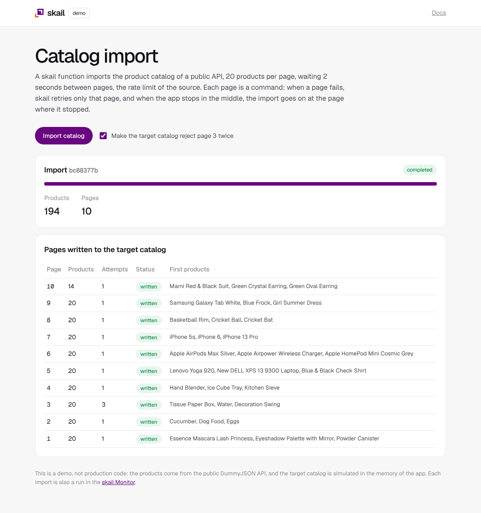

# skail catalog import (.NET 8)

[Português (Brasil)](README.pt-BR.md)

An app with a skail function that imports a product catalog from a public API, 20 products per page, and waits 2 seconds between pages, the rate limit of the source. Each page is a command: when a page fails, skail retries only that page, and when the app stops in the middle, the import goes on at the page where it stopped, without reading again the pages already imported. The demo imports the 194 products of [DummyJSON](https://dummyjson.com) in 10 pages. You start the import on a page the app serves at http://localhost:8080.

It shows three skail features:

- **durability**: close the app in the middle of an import, start it again and the import goes on at the page where it stopped;
- **automatic retries**: a page the target catalog rejects is retried alone, and writing it again replaces it, so nothing is duplicated;
- **a durable delay** between pages, which holds no thread or process.

## Requirements

- One of: [Docker](https://docs.docker.com/get-docker/), [Podman](https://podman.io/docs/installation) or the [.NET 8 SDK](https://dotnet.microsoft.com/download/dotnet/8.0) (or newer). The run script uses the first one it finds.
- A skail environment with a workload registered for the `SKAIL_WORKLOAD` in `.env` (`catalogimport:v1.0.0` by default). The [Quickstart](https://docs.skail.dev/comece-aqui/quickstart) shows how to create the account, the environment and the workload.

The project uses `Skail.Platform.Runtime` **2.3.0-rc.4**.

## Run

```bash
cp .env.example .env  # fill in SKAIL_SIDECAR, SKAIL_NAMESPACE and SKAIL_KEY (portal > Environments & keys > Connect)
scripts/run.sh        # then open http://localhost:8080
```

On Windows, in PowerShell: `copy .env.example .env`, then `powershell -ExecutionPolicy Bypass -File scripts\run.ps1`. The script works on the Windows PowerShell built into Windows; PowerShell 7 is not needed.

The script runs the demo with what the machine has: Docker, then Podman, then the .NET SDK. If it finds none of them, it says what to install. Without the script, the commands are `dotnet run`.



Each page shows up in the table as it is written to the target catalog, with the number of products, the attempts and the first products. The page refreshes itself every second, and each step is also printed to the console.

## The paths

| What you click | What happens | Result |
|---|---|---|
| **Import catalog** | 10 pages, nine of 20 products and the last of 14, 2 seconds apart | **completed**, 194 products in 10 pages |
| check **Make the target catalog reject page 3 twice**, then **Import catalog** | the target rejects the first two writes of page 3; skail retries only that page, about 15 and 30 seconds later, and the import goes on | **completed**, with 3 attempts on page 3 |

The button works again when the import ends: one import at a time.

## How it works

The app does three jobs in one process: it serves the page, it hosts the worker that runs the function (`builder.UseSkail()`), and it starts each import through the skail HTTP API. The target catalog is simulated in the memory of the app.

```http
POST {SKAIL_SIDECAR}/api/v1/trigger/catalogimport/v1.0.0/ImportCatalog/{importId}
["{importId}"]
```

The function and the page command, in [`CatalogFunctions.cs`](CatalogFunctions.cs):

```csharp
[SkailFunction]
public async SkailTask<ImportResult> ImportCatalog(string importId)
{
    var page = 1;
    var products = 0;
    while (true)
    {
        var result = await ImportPage(importId, page);
        products += result.Imported;
        if (!result.HasMore || result.Imported == 0 || page == CatalogLimits.MaxPages) break;

        page++;
        await SkailTask.DelaySeconds(CatalogLimits.SecondsBetweenPages);
    }

    var import = new ImportResult(importId, page, products);
    await ReportResult(import);
    return import;
}

[SkailCommand(retryCount: 3)]
public async SkailTask<ImportedPage> ImportPage(string importId, int page)
{
    var read = await source.GetPageAsync(page);
    desk.SavePage(importId, page, read.Products);
    return new ImportedPage(read.Products.Count, read.HasMore);
}
```

- `page` and `products` come only from the results of `ImportPage`. On a resume, skail runs the function again over the run history: the pages already imported return the recorded result without reading the source, and the loop goes on at the next page.
- `ImportPage` reads and writes in the same command. A retry runs both again (`[SkailCommand(retryCount: 3)]`): the read changes nothing, and the target replaces a page written twice (the import id and the page number are the key), so nothing is duplicated.
- The products never leave the command: its result has only the number of products and whether there are more pages, so the run history stays small.
- The loop stops when the source says there is no more, when a page comes empty, or at page 50, a cap that keeps the run history bounded if the source never reports the end.

| File | What it has |
|---|---|
| `CatalogFunctions.cs` | The function and its commands. |
| `Model.cs` | The limits, the products and the result of the import. |
| `Demo/DummyJsonSource.cs` | The call to DummyJSON. |
| `Demo/ImportDesk.cs` | Starts the imports for the page and plays the target catalog. |
| `Page/index.html` | The page, with the skail branding. |
| `Skail/SkailApiClient.cs` | The trigger through the skail HTTP API. |
| `Program.cs` | Reads `.env`, serves the page and its API, and wires everything up. |
| `scripts/run.sh`, `scripts/run.ps1`, `Dockerfile` | Run the demo with Docker, Podman or .NET, whatever the machine has. |

## See the durability

1. Run `scripts/run.sh`, open the page and click **Import catalog**.
2. After a few pages, press **Ctrl+C**. The app closes; the import stays in skail.
3. Run `scripts/run.sh` again and open the page. skail hands the app the import: it goes on at the page where it stopped, without reading again the pages already imported, and ends with 194 products. The table shows the pages written after the restart; the ones before were in the memory of the app that closed. A page that was in the middle of its command when the app closed can take a few minutes to be handed out again; the import waits for it.

In the portal, open the [Monitor](https://docs.skail.dev/referencia/portal/monitor) of your environment and click the import: it lists one `ImportPage` per page, with the `Delay` between them, and the final `ReportResult`. With the checkbox on, page 3 shows its two failed attempts.

## Notes

- Apps running the same `SKAIL_WORKLOAD` on the same environment share the same runs: use one workload (or environment) per person.

## Disclaimer

**This is a demo, not production code.** It exists only to show how [skail](https://docs.skail.dev) works and is provided "as is", without warranty of any kind. It reads a free third-party API (DummyJSON) that may change, limit or refuse requests at any time, and the target catalog is simulated.

## License

[Apache-2.0](LICENSE)
