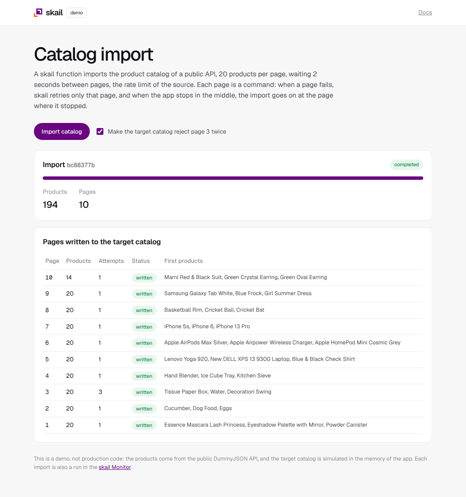

# skail catalog import (.NET 8)

[English](README.md)

Um app com uma function do skail que importa um catálogo de produtos de uma API pública, 20 produtos por página, e espera 2 segundos entre as páginas, o limite de requisições da origem. Cada página é um command: quando uma página falha, o skail tenta de novo só aquela página, e quando o app para no meio, o import continua na página onde parou, sem ler de novo as páginas já importadas. A demo importa os 194 produtos da [DummyJSON](https://dummyjson.com) em 10 páginas. Você inicia o import numa página que o app serve em http://localhost:8080.

Ele mostra três recursos do skail:

- **durabilidade**: feche o app no meio de um import, abra de novo e o import continua na página onde parou;
- **novas tentativas automáticas**: uma página que o catálogo de destino rejeita é tentada de novo sozinha, e gravá-la de novo substitui a anterior, então nada se duplica;
- um **delay durável** entre as páginas, que não segura thread nem processo.

## Requisitos

- Um destes: [Docker](https://docs.docker.com/get-docker/), [Podman](https://podman.io/docs/installation) ou o [SDK do .NET 8](https://dotnet.microsoft.com/download/dotnet/8.0) (ou mais novo). O script de execução usa o primeiro que encontrar.
- Um environment do skail com um workload registrado para o `SKAIL_WORKLOAD` do `.env` (`catalogimport:v1.0.0` por padrão). O [Quickstart](https://docs.skail.dev/comece-aqui/quickstart) mostra como criar a conta, o environment e o workload.

O projeto usa o `Skail.Platform.Runtime` **2.3.0-rc.4**.

## Rodar

```bash
cp .env.example .env  # preencha SKAIL_SIDECAR, SKAIL_NAMESPACE e SKAIL_KEY (portal > Environments & keys > Connect)
scripts/run.sh        # depois abra http://localhost:8080
```

No Windows, no PowerShell: `copy .env.example .env` e depois `powershell -ExecutionPolicy Bypass -File scripts\run.ps1`. O script funciona no Windows PowerShell que já vem no Windows; não precisa do PowerShell 7.

O script roda a demo com o que a máquina tiver: Docker, depois Podman, depois o SDK do .NET. Se não achar nenhum, ele diz o que instalar. Sem o script, os comandos são `dotnet run`.



Cada página aparece na tabela conforme é gravada no catálogo de destino, com o número de produtos, as tentativas e os primeiros produtos. A página se atualiza sozinha a cada segundo, e cada passo também aparece no console.

## Os caminhos

| O que você clica | O que acontece | Resultado |
|---|---|---|
| **Import catalog** | 10 páginas, nove de 20 produtos e a última de 14, com 2 segundos entre elas | **completed**, 194 produtos em 10 páginas |
| marque **Make the target catalog reject page 3 twice** e depois **Import catalog** | o destino rejeita as duas primeiras gravações da página 3; o skail tenta de novo só aquela página, cerca de 15 e 30 segundos depois, e o import segue | **completed**, com 3 tentativas na página 3 |

O botão volta a funcionar quando o import termina: um import por vez.

## Como funciona

O app faz três coisas no mesmo processo: serve a página, hospeda o worker que executa a function (`builder.UseSkail()`) e inicia cada import pela API HTTP do skail. O catálogo de destino é simulado na memória do app.

```http
POST {SKAIL_SIDECAR}/api/v1/trigger/catalogimport/v1.0.0/ImportCatalog/{importId}
["{importId}"]
```

A function e o command da página, em [`CatalogFunctions.cs`](CatalogFunctions.cs):

```csharp
[SkailFunction]
public async SkailTask<ImportResult> ImportCatalog(string importId)
{
    var page = 1;
    var products = 0;
    while (true)
    {
        var result = await ImportPage(importId, page);
        products += result.Imported;
        if (!result.HasMore || result.Imported == 0 || page == CatalogLimits.MaxPages) break;

        page++;
        await SkailTask.DelaySeconds(CatalogLimits.SecondsBetweenPages);
    }

    var import = new ImportResult(importId, page, products);
    await ReportResult(import);
    return import;
}

[SkailCommand(retryCount: 3)]
public async SkailTask<ImportedPage> ImportPage(string importId, int page)
{
    var read = await source.GetPageAsync(page);
    desk.SavePage(importId, page, read.Products);
    return new ImportedPage(read.Products.Count, read.HasMore);
}
```

- `page` e `products` vêm só dos resultados do `ImportPage`. Na retomada, o skail roda a function de novo sobre o histórico da execução: as páginas já importadas devolvem o resultado registrado sem ler a origem, e o laço segue na próxima página.
- O `ImportPage` lê e grava no mesmo command. Uma nova tentativa roda as duas coisas de novo (`[SkailCommand(retryCount: 3)]`): a leitura não muda nada, e o destino substitui uma página gravada duas vezes (o id do import e o número da página são a chave), então nada se duplica.
- Os produtos nunca saem do command: o resultado tem só o número de produtos e se há mais páginas, então o histórico da execução fica pequeno.
- O laço para quando a origem diz que não há mais, quando uma página vem vazia ou na página 50, um limite que mantém o histórico da execução contido se a origem nunca avisar o fim.

| Arquivo | O que tem |
|---|---|
| `CatalogFunctions.cs` | A function e os commands dela. |
| `Model.cs` | Os limites, os produtos e o resultado do import. |
| `Demo/DummyJsonSource.cs` | A chamada à DummyJSON. |
| `Demo/ImportDesk.cs` | Inicia os imports da página e faz o papel do catálogo de destino. |
| `Page/index.html` | A página, com a marca do skail. |
| `Skail/SkailApiClient.cs` | O trigger pela API HTTP do skail. |
| `Program.cs` | Lê o `.env`, serve a página e a API dela, e liga tudo. |
| `scripts/run.sh`, `scripts/run.ps1`, `Dockerfile` | Rodam a demo com Docker, Podman ou o .NET, o que houver na máquina. |

## Veja a durabilidade

1. Rode `scripts/run.sh`, abra a página e clique em **Import catalog**.
2. Depois de algumas páginas, aperte **Ctrl+C**. O app fecha; o import continua no skail.
3. Rode `scripts/run.sh` de novo e abra a página. O skail entrega o import ao app: ele continua na página onde parou, sem ler de novo as páginas já importadas, e termina com 194 produtos. A tabela mostra as páginas gravadas depois do reinício; as de antes estavam na memória do app que fechou. Uma página que estava no meio do command quando o app fechou pode levar alguns minutos para ser entregue de novo; o import espera por ela.

No portal, abra o [Monitor](https://docs.skail.dev/referencia/portal/monitor) do seu environment e clique no import: ele lista um `ImportPage` por página, com o `Delay` entre elas, e o `ReportResult` final. Com a caixa marcada, a página 3 mostra as duas tentativas com falha.

## Observações

- Apps rodando o mesmo `SKAIL_WORKLOAD` no mesmo environment dividem as mesmas execuções: use um workload (ou environment) por pessoa.

## Aviso

**Esta é uma demonstração, não é código de produção.** Ela existe só para mostrar como o [skail](https://docs.skail.dev) funciona e é fornecida "como está", sem garantia de nenhum tipo. Ela lê uma API gratuita de terceiros (a DummyJSON), que pode mudar, limitar ou recusar requisições a qualquer momento, e o catálogo de destino é simulado.

## Licença

[Apache-2.0](LICENSE)
