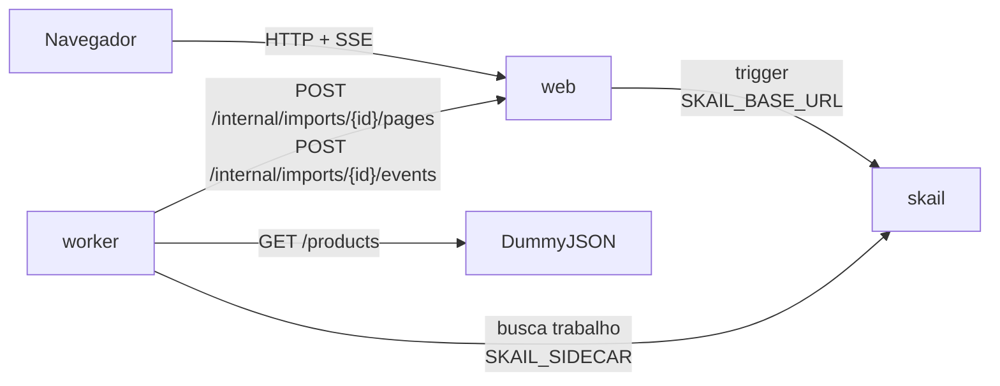

# skail catalog import (.NET 8)

[English](README.md)

Uma function do skail importa um catálogo de produtos de uma API externa, 20 produtos por página, e espera 2 segundos entre as páginas, o limite de requisições da origem. Cada página é um command: quando uma página falha, o skail repete só essa página, e quando o worker cai no meio, a importação continua na página em que parou, sem ler de novo as páginas já importadas. A demo importa os 194 produtos do DummyJSON em 10 páginas. Uma página web inicia a importação, mostra cada página conforme ela é gravada e tem uma caixa de seleção que faz o catálogo de destino recusar a página 3 duas vezes.

A demo mostra três tópicos da [documentação do skail](https://docs.skail.dev):

- [hibernação e retomada](https://docs.skail.dev/construa/conceitos/hibernacao-e-retomada): depois de uma queda, a execução continua na página em que parou;
- [retries e idempotência](https://docs.skail.dev/construa/conceitos/retries-e-idempotencia): uma página que falhou é repetida sozinha, e gravar de novo substitui a página;
- [passar dados entre função e commands](https://docs.skail.dev/construa/como-fazer/passar-dados-entre-funcao-e-commands): os produtos ficam dentro do command, e só a contagem vai para o histórico da execução.

## Como funciona



- **worker** (`src/SkailCatalogImport.Worker`): a function `ImportCatalog(importId)` no `CatalogFunctions.cs` e os commands dela no `CatalogCommands.cs`. O `ImportPage(importId, page)` lê uma página da origem e grava no catálogo de destino; o `ReportStatus` avisa a página web do andamento da execução. Os commands delegam para o `CatalogOperations`, então a lógica deles é testada sem o skail.
- **web** (`src/SkailCatalogImport.Web`): página estática e API. Inicia a execução (trigger), faz o papel do catálogo de destino com os produtos em memória e transmite o estado para a página (SSE).
- **contracts** (`src/SkailCatalogImport.Contracts`): tipos e constantes usados pelo worker e pelo web.

A function só orquestra e deixa o I/O para os commands. A espera de 2 segundos é um delay durável ([tempo e agendamento](https://docs.skail.dev/construa/conceitos/tempo-e-agendamento)), que não segura thread nem processo. O trecho abaixo é uma versão simplificada do [`CatalogFunctions.cs`](src/SkailCatalogImport.Worker/CatalogFunctions.cs), que também avisa a página web do início, do fim e de uma falha:

```csharp
var page = 1;
var products = 0;
while (true)
{
    var result = await commands.ImportPage(importId, page);
    products += result.Imported;
    if (!result.HasMore || result.Imported == 0 || page == CatalogLimits.MaxPages) break;

    page++;
    await SkailTask.DelaySeconds(CatalogLimits.SecondsBetweenPages);
}
return new ImportResult(importId, page, products);
```

`page` e `products` vêm só dos resultados do `ImportPage`. Numa retomada, o skail executa a function de novo sobre o histórico da execução: as páginas já importadas devolvem o resultado gravado sem ler a origem, e o laço continua na página seguinte.

O `ImportPage` lê e grava no mesmo command. Uma nova tentativa faz as duas coisas de novo: a leitura não altera nada, e o destino substitui uma página gravada duas vezes (o id da importação e o número da página são a chave), então nada é duplicado. Os produtos nunca saem do command: o resultado tem só o número de produtos importados e se há mais páginas.

O laço para quando a origem diz que não há mais nada, quando uma página vem vazia ou na página 50. O limite mantém o histórico da execução sob controle se a origem nunca avisar o fim (ver [limites](https://docs.skail.dev/referencia/limites-e-cotas)).

## Os caminhos

A página web tem o botão **Import catalog** e a caixa de seleção **Make the target catalog reject page 3 twice**.

| O que você faz | O que acontece | Resultado |
|---|---|---|
| **Import catalog** | 10 páginas, nove de 20 produtos e a última de 14, com 2 segundos entre elas | **Completed**, 194 produtos em 10 páginas |
| Marca a caixa e clica em **Import catalog** | o destino responde `503` às duas primeiras gravações da página 3; o skail repete só essa página, e a importação segue | **Completed**, com 3 tentativas na página 3 |
| `scripts/run.sh kill-worker` no meio, depois `scripts/run.sh start-worker` | a importação continua na página seguinte | **Completed**, com 1 tentativa nas páginas importadas antes da queda |

A coluna **Attempts** conta as gravações que o destino recebeu para cada página. Enquanto a página 3 é recusada, a linha dela mostra "rejected, retrying". Quando uma página falha em todas as tentativas, a function avisa **Failed** com o número da página e o erro, e as páginas já gravadas continuam gravadas. A contagem regressiva entre as páginas é só visual: a espera de verdade é o delay no skail. Recarregar a página web durante uma importação reconecta a ela.

## Como conecta ao skail

| Serviço | Variável | Para quê |
|---|---|---|
| worker | `SKAIL_SIDECAR` | Conecta a function ao seu environment e recebe o trabalho dela. |
| web | `SKAIL_BASE_URL` | Inicia execuções pela API HTTP do skail. |

Os dois usam os mesmos `SKAIL_WORKLOAD`, `SKAIL_NAMESPACE` e `SKAIL_KEY`. O web faz uma chamada por importação:

```http
POST {SKAIL_BASE_URL}/api/v1/trigger/{nome}/{versao}/ImportCatalog/{importId}
["{importId}"]
```

`{nome}` e `{versao}` vêm de `SKAIL_WORKLOAD` (`nome:versao`). A chamada manda a chave em `skail-key` e em `Authorization: Bearer`, mais o header `Skail-namespace`, como descrito em [autenticação](https://docs.skail.dev/referencia/api-http/autenticacao). `429`, `5xx` e erros de rede são repetidos com o mesmo id da importação. `401` e `403` não são repetidos: confira `SKAIL_KEY` e `SKAIL_NAMESPACE`.

O navegador nunca chama o skail. Ele só fala com o web, então a chave fica no servidor.

## Requisitos

- SDK do .NET 8
- podman ou docker
- PowerShell 7+ (`pwsh`), só se você usar o `scripts/run.ps1` em vez do `scripts/run.sh`
- Um environment do skail com o workload de `SKAIL_WORKLOAD` cadastrado (`catalogimport:v1.0.0` por padrão). O [Quickstart](https://docs.skail.dev/comece-aqui/quickstart) mostra como pedir a conta, criar o environment e cadastrar o workload.
- Acesso a <https://dummyjson.com>, de onde vêm os produtos. Sem ele, use `SOURCE_PROVIDER=fake`, que serve os mesmos 194 produtos sem internet.
- Um navegador atual (Chrome/Edge 111+, Firefox 113+, Safari 16.2+). A página usa Server-Sent Events, `color-mix()` do CSS e JavaScript moderno.

## Configurar

```bash
cp .env.example .env     # o .env guarda a chave e é ignorado pelo git
```

Preencha `SKAIL_WORKLOAD` (exatamente como está cadastrado no portal), `SKAIL_NAMESPACE`, `SKAIL_KEY`, `SKAIL_SIDECAR` e `SKAIL_BASE_URL` com os valores do seu environment.

O worker lê `WEB_BASE_URL`, `SOURCE_PROVIDER` e `SOURCE_API_URL` quando sobe, então mudar esses valores só pede um reinício do worker.

## Rodar com podman ou docker

```bash
scripts/run.sh up        # builda as duas imagens e sobe web + worker
scripts/run.sh logs
scripts/run.sh down
```

`CONTAINER_ENGINE=docker` força o docker. No Windows, ou em qualquer sistema com PowerShell 7+, rode `pwsh scripts/run.ps1 <comando>` com os mesmos comandos; `$env:CONTAINER_ENGINE = "docker"` força o docker.

Abra <http://localhost:8080> e clique em **Import catalog**.

### Ver a durabilidade

1. Clique em **Import catalog**.
2. Depois de algumas páginas, rode `scripts/run.sh kill-worker`. Ele mata o worker com SIGKILL, como numa queda; a importação para, e o web mantém o estado da página.
3. Rode `scripts/run.sh start-worker`.
4. A importação continua na página seguinte e termina com 194 produtos. As páginas importadas antes da queda mostram 1 tentativa, porque não foram lidas de novo. Se a queda pegou uma página no meio da gravação, essa página mostra 2 tentativas, e o destino guarda uma cópia só dela.

No portal, abra o [Monitor](https://docs.skail.dev/referencia/portal/monitor) do seu environment e procure pelo id da importação, que a página web mostra no rodapé. A execução lista o `ReportStatus`, depois um `ImportPage` e um `Delay` para cada página, sem `Delay` depois da última, e um `ReportStatus` no fim. Com a falha simulada, as tentativas recusadas da página 3 aparecem como erros ao lado do `ImportPage` dela, com a mensagem `Target catalog answered 503 to the write of page 3: simulated failure on page 3`. A linha de log de cada página também aparece na execução, como `Page 3: 20 products written in 169 ms`. Numa execução sem falhas, o **E2E Duration** foi de 22,4 s e o **Duration** de 3,1 s, porque as esperas entre as páginas não ocupam o worker.

## VS Code

Abra a pasta e aceite as extensões recomendadas (C# Dev Kit).

- `Ctrl+Shift+B` compila, a task *test* roda os testes e as tasks `containers: up/down/logs/kill-worker/start-worker` chamam o `scripts/run.sh`.
- A configuração de debug **Worker + Web** sobe os dois projetos lendo o `.env`, e um breakpoint dentro de um command funciona. Fora de container, o worker acessa o web em `localhost` (`WEB_BASE_URL`, definido no `launch.json`).

## Testes

```bash
dotnet test
```

Os testes unitários cobrem os contratos, a origem (DummyJSON e offline), as chamadas ao catálogo de destino e ao web, as operações por trás dos commands, o estado das importações (tentativas, falha simulada, página gravada duas vezes), as regras do botão, as chamadas ao skail (trigger e novas tentativas) e a API web com SSE. Eles não precisam de rede nem do skail. A function em si roda no skail: os caminhos acima e os passos de durabilidade são a forma de conferir.

## Observações

- O catálogo de destino fica na memória do web. Reiniciar o web perde os produtos e o histórico da página; a importação continua rodando no skail, mas o web ignora as páginas de importações que ele não conhece. Um destino de verdade seria uma tabela com upsert pelo id da importação e pela página (ver [commands idempotentes](https://docs.skail.dev/construa/como-fazer/escrever-commands-idempotentes)).
- O DummyJSON é uma API pública de testes, sem SLA. Quando ele falha, o skail repete a página do mesmo jeito que faz com a falha simulada.
- As rotas `/internal/imports/...`, que o worker chama, não têm autenticação. Para uma demo local isso basta; proteja as rotas antes de usar o padrão em produção.
- Workers com o mesmo `SKAIL_WORKLOAD` no mesmo environment dividem as mesmas execuções: use um workload (ou environment) por pessoa.

## Licença

[Apache-2.0](LICENSE)
